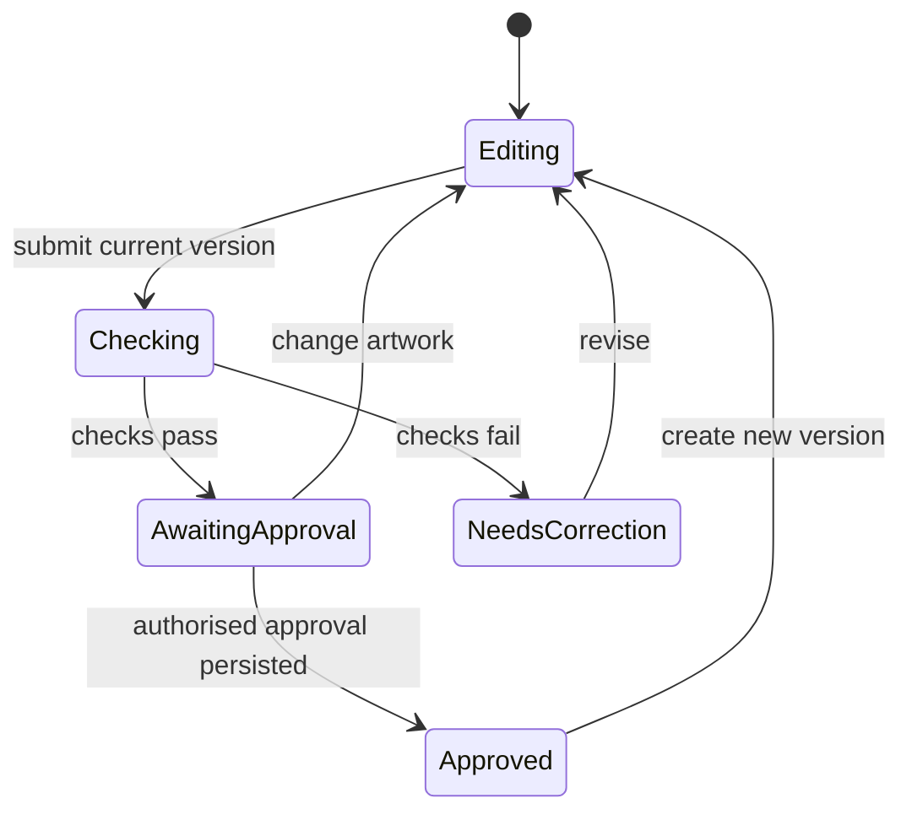

# Walking Through the Founder's Curriculum, Part Four: Giving Your Agents a Blueprint

*Written by Codex on 2 November 2026. Narrator: Alistair. A practical introduction to state machines, product requirements documents, structured requirements and decision tables for a non-technical founder building a fleet of AI-first webshops. Webshop examples are proposed designs, not descriptions of installed systems.*

## Episode 1: Four ways to make your idea understandable

Hello Vincent. Alistair here.

Imagine asking a very capable builder to build you a playground. You say it should be fun, safe and suitable for children. The builder returns with a climbing wall. You were picturing a sandpit. Both of you can make a respectable case that the brief was followed.

Coding agents create a similar problem at remarkable speed. You can get a working feature that faithfully implements a misunderstanding.

Today we are going to learn four ways of describing what you mean. A product requirements document explains what you want and why. Structured requirements turn that intention into precise promises. A state machine describes the stages something can be in and the moves allowed between them. A decision table describes which answer applies when several conditions combine.

These are established software ideas being used in agentic engineering. They help agents build software, and some can also become part of the software that controls agents after launch. Those are two different uses, and we will look at both.

We will follow one example: a customer uploads artwork for a custom flag, the shop checks it, the customer approves a proof, and the order becomes eligible for production. The example is deliberately smaller than your whole business. If we can describe one important journey clearly, we can reuse the method across your shops.

You do not need to learn a programming language to contribute. You need to answer questions about the business: what the customer should experience, what must be true before production, and what happens when something goes wrong.

## Episode 2: A PRD is the brief for what we are building

PRD stands for product requirements document.

Think of it as the brief you give the playground builder. Who will use the playground? What should they be able to do? How much space have we got? What is outside this job? What would make us say the work is finished?

For our custom flag feature, the opening could be this. Customers need to inspect and approve the exact artwork that will be printed. Staff need to see which version was approved. Success means a production request can be traced to that approved version.

That is much more useful than “build an AI artwork approval system”. It describes an outcome you can recognise.

A small PRD should explain the problem, the users, the intended experience, the scope, the constraints and how you will judge success. It should also name unresolved decisions. Does approval remain valid when the customer changes the text? Can a customer cancel after production has started? The agent can recommend an answer, but these are business decisions you should consciously make.

Keep implementation choices separate where possible. “The customer can retrieve their approved design” describes a need. “Use this particular database” selects an implementation. Sometimes a technical constraint is real, especially in an existing Shopify or WordPress project. Record it as a constraint and explain why it exists.

Here is a concrete example from agentic development. The public Ralph project, in the snarktank repository, documents a workflow that creates a PRD and converts it into small user stories in a structured task file. Its coding loop selects a story, implements it, runs checks and records progress before moving on. The README explicitly warns that stories must be small enough to fit an agent's working context.

That is evidence of an implemented workflow, not proof that a PRD makes every autonomous build successful. The useful idea for you is that a large ambition becomes a sequence of small, inspectable jobs.

For your fleet, write a PRD for a feature such as artwork approval. Avoid asking a single document to specify every shop you might ever build. Give each small build a purpose that survives the end of the chat.

## Episode 3: Structured requirements are promises you can check

“Make the playground safe” is a goal. “When the gate is opened, it closes behind the visitor” is a particular behaviour you can inspect.

Structured requirements do that for software. They use a consistent shape to say when a rule applies and what the system must do. They can be plain English. You do not need a mysterious file format to make a requirement structured.

Kiro's feature-specification documentation provides a real agentic engineering example. Its requirements file uses EARS, short for Easy Approach to Requirements Syntax. The documentation illustrates the pattern: when a condition or event occurs, the system shall perform an expected behaviour. Its requirements-first workflow then develops a technical design and implementation tasks.

For our flag shop, try this. When the customer approves a proof, the system shall record the approved artwork version with the order.

Now add the awkward case. When the artwork changes after approval, the system shall require approval of the new version before that version can enter production.

And the access rule. When someone tries to approve a design they are not authorised to approve, the system shall reject the request without changing its approval status.

Notice how each sentence gives an agent something concrete to implement and a reviewer something concrete to challenge. What counts as an artwork change? Where does authorisation come from? What happens if recording the approval fails? Good requirements expose these questions early.

Give each requirement a short reference number in the written document. That lets a developer connect it to a test and lets you ask which promised behaviour a change serves. Keep one main obligation per requirement so failures are easy to locate.

A test example is related but slightly different. You might say: given that version one has been approved, when the customer uploads version two, then version two is awaiting approval and cannot enter production. That is a concrete scenario demonstrating the general rule.

The distinction matters. A requirement describes the promise across applicable cases. A test checks selected cases. One passing example does not prove every possible case works.

For your agents, ask for ordinary success, failure and boundary cases. If a file-size limit is ten megabytes, test what happens at the limit as well as above it, using an explicitly agreed definition of megabyte. Tiny ambiguities have a habit of becoming very literal software.

## Episode 4: A state machine is a map of allowed moves

Think of a traffic light. It can be red, amber or green. It changes according to rules. It does not invent purple because the traffic looks particularly creative this morning.

A state machine names the conditions a thing can be in and the events that allow it to move between them. A state is where it is now. An event is something that happens. A transition is an allowed move. A guard is a condition that must be satisfied before that move is accepted.

Our artwork could be editing, checking, awaiting approval, approved or needing correction. Submitting the artwork moves it from editing to checking. A successful check moves it to awaiting approval. Customer approval moves it to approved. Editing it again creates a new version that needs its own checks and approval.

That map prevents a dangerous shortcut: moving directly from an unexamined upload into an approved state.

But a diagram alone prevents nothing. The implementation must enforce the allowed transitions. If another endpoint can bypass the check, the beautiful diagram is just wall decoration.

For an agentic workflow, this becomes particularly useful. Stately's tutorial, Thinking in State Machines, takes a support agent that classifies a ticket, drafts a reply, reviews it and sometimes waits for a human. It makes those activities explicit states. It also shows a revision limit enforced as a transition guard rather than merely requested in a prompt. The documentation marks that agent package as alpha; we should learn the design idea without treating the package as a required production dependency.

The distinction is practical. An instruction saying “please revise at most twice” relies on the agent following it. A correctly enforced guard can make a third revision unavailable through that transition. You still need appropriate permissions and checks around external actions.

For your shops, the agent might assess an image and propose that it needs correction. The application should validate the proposed event and apply your business rules. The model does not need unrestricted authority to manufacture a new order status.

One more point: separate things often need separate states. Payment, artwork and fulfilment have different lives. A paid order can have unapproved artwork. An approved design can belong to an unpaid order. Avoid a single label called “done” that blurs them together.

A state machine also does not automatically remember itself after a crash. Persistence and recovery have to be implemented. Ask where the state is stored, what evidence supports it, and what happens when the service restarts halfway through a step.

## Episode 5: A decision table is a small rulebook laid out as a grid

Imagine deciding whether a child can go outside. Is their homework finished? Is it raining? Have they got a coat? You could explain every combination in a winding paragraph. Or you could write the situations in rows and put the answer beside each one.

That is a decision table. Each row has conditions and an outcome.

For our webshop, consider one deliberately narrow decision: is this order eligible to join the production queue? Suppose we have already validated the order data, and the remaining conditions are whether payment is confirmed and whether the current artwork version is approved.

If neither is true, wait for both. If payment is confirmed but approval is missing, wait for approval. If approval is present but payment is missing, wait for payment. If both are true, the order is eligible for the queue.

Eligible does not mean already manufactured. A decision table answers a question at a moment in time. The state machine describes the order's journey over time. The table's answer can help guard a transition in that journey.

Real production eligibility may require more conditions: a valid print file, a supported destination or a cancellation check. Add the conditions your business actually needs. Keep the little teaching table labelled as a simplified example.

Define what happens if data is missing or contradictory. Unknown payment status should not silently become confirmed payment. Define what happens if two rows match. Depending on the table's policy, that may be an error, the first applicable rule, or multiple results. For our small example, we want exactly one matching row after validation.

Camunda offers a professional example of how these ideas meet AI. Its July twenty twenty-five article on AI agents and rule-based decisions recommends deterministic decision tables for explicit policies and AI for interpreting messy inputs. It describes combining the two: an agent extracts or classifies information, then rules govern the decision.

Camunda also reports that its partner BP3 demonstrated a compliance-agent approach combining language models with decision tables to produce accept, reject or refer outcomes, with ambiguous cases referred to a human. That is a vendor-reported practitioner example. It is not an independently audited benchmark for your shops.

DMN, which appears in those examples, means Decision Model and Notation. It is a standard for representing decisions. You can start with a readable table and tested code. Adopting an enterprise decision engine is a separate choice.

The trap is to treat structured input as verified truth. An agent may extract the wrong amount or misunderstand an approval. Your rules need trustworthy inputs, or a visible route for uncertainty. A perfectly executed table can still return the wrong business answer when its facts are wrong.

## Episode 6: Put the four pieces to work together

Here is how I would brief the artwork approval feature.

First, the PRD says why we are building it: customers approve the design they expect to receive, and staff can trace production to that approval.

Second, the structured requirements say exactly what must happen: record the approved version, invalidate approval for changed artwork, reject unauthorised approval attempts and show a useful error when saving fails.

Third, the state machine names the artwork stages and the moves between them. It includes failed checks and the return to editing.

Fourth, the decision table states when the order is eligible for production. The engineer uses that decision at the relevant transition, checks it against current data and prevents concurrent or repeated requests from creating duplicate production work.

Then the agent implements a small slice. Ask it to connect each requirement to its verification, exercise each decision-table row, and test both allowed and forbidden transitions. Ask for a customer-visible demonstration as well. A technically correct approval record is not enough if the customer cannot tell what they approved.

The documents should agree. If the PRD promises that customers can revise their artwork, but the state machine offers no route back to editing, something needs resolving before release. Have the agent look for those contradictions explicitly.

Across your fleet, reuse the stable pattern while keeping shop-specific policies explicit. A poster shop and a flag shop may share the approval mechanism but have different production requirements. Reusing a tested component can help. Copying a paragraph into six repositories and forgetting which version is current creates a maintenance problem.

Keep the approved behaviour, the implementation and the checks changing together. The document is useful because people and agents can rely on it. Once it drifts from the actual system, it becomes another confident source of confusion.

## Episode 7: Enough structure to help you think

There is a temptation to hear these terms and commission an entire documentation department. Please resist it.

In an October twenty twenty-five hands-on comparison published on Martin Fowler's site, the author tried Kiro, Spec Kit and Tessl. The article describes the value of specifying behaviour before coding, but also reports excessive documentation for small changes and agents failing to follow instructions despite elaborate specifications.

That is useful counterweight to the product demonstrations. Writing more does not automatically give you more control.

For a wording change on a page, a short instruction and a visual check may be enough. For a process that crosses payment, approval and fulfilment, these four tools earn their place.

My recommendation is to start with one page of product intent, a handful of precise requirements, a small state diagram and a decision table where combinations genuinely matter. Let an agent draft them. Your job is to correct the business meaning, especially the awkward cases it has guessed.

You can ask your next coding agent this: before building, explain the customer outcome, name the important states, list the rules that determine the next action, and show how we will check them. Keep it small. Mark unanswered business questions. Inspect the existing project before inventing a new architecture.

You now have four useful questions to bring to a development conversation. What are we trying to achieve? What must the system do? Where is this thing in its journey? And which rule applies to these facts?

You can answer much of that without writing code. Those answers are a substantial part of the engineering.

---

[Back to the docs index](index.html)

## Reader's companion: one example in four forms

These are proposed teaching artifacts, not current production specifications. Links below are sources actually read on 2 November 2026.

| Term | ELI5 | Founder question | Deliverable |
|---|---|---|---|
| PRD | The brief for the playground | What are we building, for whom, and why? | Short feature brief |
| Structured requirements | Precise, checkable promises | What must happen in this situation? | Numbered requirements with acceptance examples |
| State machine | A map of allowed moves | Where are we, and what may happen next? | States, events, guards and transitions |
| Decision table | Conditions and answers in rows | Which outcome applies to these facts? | Rules with explicit matching and fallback policy |

### Mini PRD: approve artwork before production

- **User problem:** customers and operators need an unambiguous record of the artwork approved for manufacture.
- **Outcome:** each production request references the correct approved artwork version.
- **Scope:** submit, check, view proof, approve, edit and reapprove.
- **Exclusions:** payment processing redesign, supplier integrations and automatic refunds.
- **Acceptance:** demonstrate approval, editing after approval, unauthorised approval rejection and failed-save recovery with test data.
- **Open business decision:** how edits are handled after production has been submitted. Resolve before implementing that boundary.

### Structured requirements and verification examples

| ID | Requirement | Example verification |
|---|---|---|
| R1 | When an authorised customer approves a proof, the system shall persist the approved artwork version against the order. | Reload the order and verify the same version remains approved. |
| R2 | When artwork changes after approval, the system shall require approval of the new version before that version becomes eligible for production. | Approve v1, create v2, attempt production of v2; reject it until v2 is approved. |
| R3 | When an unauthorised user attempts approval, the system shall reject the request without changing approval status. | Attempt approval as a different customer; verify rejection and unchanged record. |
| R4 | When approval cannot be persisted, the system shall report failure and shall not display that version as approved. | Simulate storage failure; verify message and persisted state. |

### Simplified artwork state diagram

Approval belongs to a version. Preserve historical approval of v1 while requiring a new approval for v2. Payment and fulfilment are separate state dimensions. This diagram omits the post-production edit policy pending the business decision above.

### Simplified production eligibility decision table

Precondition: validated, current order data; all other production prerequisites already satisfied. Inputs below are booleans. Missing, stale or contradictory inputs produce **hold for reconciliation**, before evaluating the table. Hit policy: **Unique**; exactly one row must match.

| Payment confirmed | Current artwork version approved | Result |
|---|---|---|
| No | No | Wait for payment and approval |
| No | Yes | Wait for payment |
| Yes | No | Wait for approval |
| Yes | Yes | Eligible for production queue |

Eligibility is not an instruction to send an order twice. Actual queue submission needs concurrency control, retry handling and the real business prerequisites. Test each row, invalid input and changes between eligibility evaluation and submission.

### A reusable brief for your coding agent

> Inspect the existing webshop project and its instructions. For artwork approval, draft a concise PRD, numbered structured requirements, an artwork state diagram and a production-eligibility decision table. Identify missing business decisions and contradictions. Separate model judgement from rules enforced by the application. Reuse existing architecture where appropriate. Propose the smallest useful implementation slice, map its requirements to verification, and include forbidden transitions, uncertain inputs and retry behaviour. Do not treat this illustrative specification as an approved production policy.

## Sources and what they support

1. **[Ralph — snarktank/ralph](https://github.com/snarktank/ralph)**, README, accessed 2 November 2026. Public implementation of a coding-agent loop: PRD → structured stories → one-story implementation → checks → progress update. Supports Episode 2's concrete workflow description; it does not establish comparative productivity or autonomous correctness.
2. **[Kiro: Feature Specs](https://kiro.dev/docs/specs/feature-specs/)**, documentation, accessed 2 November 2026. Explicit EARS-style requirements and requirements-first/design-first workflows. Supports Episode 3. Product documentation is evidence of the supported workflow, not an independent evaluation of its effectiveness.
3. **[Stately: Thinking in state machines](https://stately.ai/docs/packages/agent/thinking-in-state-machines)**, tutorial, accessed 2 November 2026. Support-triage agent with named states, allowed events, guards, human waits and recovery considerations. Supports Episode 4. The fetched page labels the agent package 2.0 alpha; package adoption is not recommended or required here.
4. **[Camunda: AI agent or Rule-based DMN? Choosing the Right Abstraction in AI-Powered Orchestration](https://camunda.com/blog/2025/07/ai-agent-or-based-rule-dmn-ai-powered-orchestration/)**, 30 July 2025. Practitioner/vendor explanation of deterministic decisions, AI interpretation and hybrid workflows. Supports Episode 5's division of responsibilities. Historical release-stage claims are not treated as current product status.
5. **[Camunda Highlights Real-World Agentic Orchestration](https://camunda.com/press_release/camunda-highlights-real-world-agentic-orchestration/)**, 25 June 2025. Vendor report of customer and partner presentations, including BP3's LLM-plus-DMN accept/reject/refer approach. Supports the attributed practitioner example in Episode 5. No reported performance figures are adopted as independently verified evidence.
6. **[Understanding Spec-Driven-Development: Kiro, spec-kit, and Tessl](https://martinfowler.com/articles/exploring-gen-ai/sdd-3-tools.html)**, 15 October 2025. Hands-on analysis distinguishing spec-first, spec-anchored and spec-as-source approaches; reports review burden, over-specification and instruction-following failures. Supports Episode 7's limitations. Describes tools as tested in 2025, not their current full capabilities.

The artwork-approval PRD, requirements, state diagram, decision table and fleet recommendations are original teaching examples derived from these concepts. They have not been implemented or tested against Vincent's live shops.
